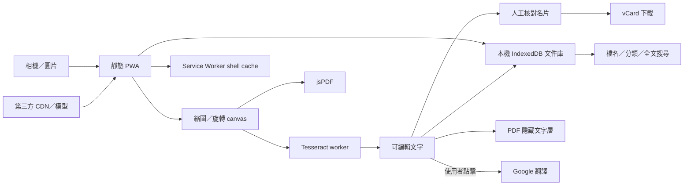

# S1 既有工具與架構
## 0.6 增補
沿用純前端／IndexedDB。11–13新增本機日期候選→人工確認ICS、文字框行列啟發式→可編輯表格→原生OOXML/CSV、原生BarcodeDetector→同源ZXing JS 0.1.5後備。14–15選擇可用時的瀏覽器LanguageModel（文字／image），中日語文字透過Translator本機橋接；不引入API金鑰、後端或文件上傳。當前IAB文字與影像模型不可用，實驗接入不當作V2完成。若改雲端模型，須先取得使用者改變本機資料邊界的明確授權。

2026-10-17；既有專案盤點版。

## 需求摘要與 MVP
繁體中文個人掃描 PWA：相機／多張圖片匯入、頁序／旋轉／刪除、A4 圖片 PDF、OCR、人工核對名片欄位及 vCard。保留既有 Google 翻譯連結。
原始範圍不含原生 App Store 套件、帳號、同步、文件庫、自動透視裁切或可搜尋 PDF。2026-10-17 使用者追加 15 項路線圖並確認本機保存；新 MVP 加入 IndexedDB 文件庫、矩形自動裁切及可搜尋 PDF，見 06-feature-roadmap.md。帳號／跨裝置同步、透視校正仍不在本輪。

## 現有工具與 Build / Buy / Fork
| 工具 | 用途與決策 | 授權／限制 | 官方來源 |
|---|---|---|---|
| Tesseract.js | 延用瀏覽器 OCR | Apache-2.0；準確率需自行量測，不能直接辨識 PDF | https://github.com/naptha/tesseract.js |
| jsPDF | 延用瀏覽器產生 A4 PDF | MIT；此實作是圖片 PDF | https://github.com/parallax/jsPDF |
| Web App Manifest + Service Worker | 延用 PWA 安裝及 shell cache | 安裝行為依平台；部署需 HTTPS | https://developer.mozilla.org/en-US/docs/Web/Progressive_web_apps/Guides/Making_PWAs_installable |

本次延續已存在的選型，不重新做完整商業產品與開源競品調查；不以這份盤點主張最佳產品或最低成本。

## 架構圖

## 主要資料流
匯入檔案 → 記憶體 pages → 調整頁序／方向 → canvas → PDF 或 OCR。OCR 文字 → 人工編輯 → 複製／名片欄位／翻譯連結。
圖片不主動上傳伺服器；翻譯連結會傳送文字給 Google，介面既有隱私說明保留。

## 技術棧與資料模型
HTML/CSS/vanilla JS、Cloudflare Workers static assets。延續既有實作，因此不額外導入 React、Supabase 或 API。
原稿 `Page={file: File,url: objectURL,rotation: 0|90|180|270}`，排序即 pages 陣列順序。0.4 加入 crop、text、word bbox 與 OCR 尺寸／變換身份；文件庫保存 `Document={id,name,category,text,pages,contact,language,mode,createdAt,updatedAt}`。每頁保留原圖 File，暫時 objectURL 不寫入 DB。所有儲存均為本機 IndexedDB，無遠端後端或登入。

## S2 / S3 交接
0.5 延伸仍為純前端：Translator API 本機語言模型（平台限定）、本機 vCard QR（Nayuki v1.8.0 MIT）、documents store 支援 kind=contact/pages=[] 聯絡人與 receipt/translation 欄位。批次 JPEG 及 ZIP 在記憶體產生，不新增 API／遠端儲存；未改變不登入、不上傳文件的決策。Google 外連仍獨立且會傳文字。詳見 04 與 06。

確認 iPhone 相機檔案格式、安裝圖示、下載分享流程；用自製中英日樣本測 OCR、旋轉與 PDF 實際方向。不要把欄位猜測當成準確名片辨識。
